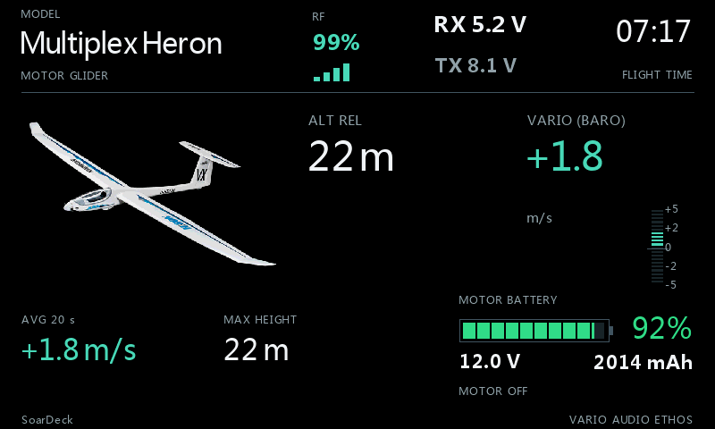
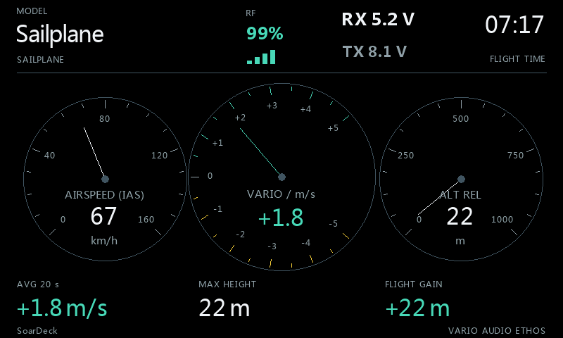

# SoarDeck

Sailplane and motor-glider instruments for FrSky ETHOS, in the VoltDeck and GasDeck family.

**SoarDeck 2026.11-v4** · Suite **26.11.4**

[Download the release ZIP](https://github.com/bliatun-code/SoarDeck/releases/download/soardeck-2026.11-v4/SoarDeck-2026.11-v4.zip) · [Illustrated walkthrough](docs/Walkthrough.md) · [Norsk bildeguide](docs/Bildeguide-norsk.md)

## Choose your instruments

- **Deck:** large digital altitude and climb readings.
- **Classic:** round instruments inspired by sailplane panels.
- **Thermal:** averaged climb and recent altitude/vario history.
- **Daylight:** a light background for a different viewing preference.
- Choose **Sailplane** or **Motor glider**, then show a model picture or give its area to instruments.
- Add actual pitot airspeed, GPS ground speed, RX/TX voltage and link readings when those sources exist.
- Motor energy supports guarded consumed mAh, a percent sensor or a labelled voltage estimate.

The [walkthrough](docs/Walkthrough.md) shows all **16 combinations** with a source table for each example profile.
Screenshots show the actual app in the ETHOS simulator with illustrative telemetry.

## Flight log

Review altitude, climb and sink after a flight. On a motor glider, see motor time separately and mark motor runs in the altitude history using a switch and throttle. [See the illustrated examples](docs/Walkthrough.md#motor-ready-and-motor-on).

## Install

1. Download **SoarDeck-2026.11-v4.zip** from [Releases](https://github.com/bliatun-code/SoarDeck/releases/latest).
2. Back up the model and settings. Connect the radio's script storage in FrSky Suite.
3. Open **Lua library → Install Lua scripts**, select the ZIP and click **Install scripts**.
4. Restart ETHOS. Add **SoarDeck** to a full-screen widget area and open **Configure widget**.
5. Choose the model type and review the suggested sources in [Sensor setup](docs/Configuration.md#sensor-setup).

For manual installation, copy all six files from the ZIP to `/scripts/SoarDeck/`. `main.lua` only loads `deck.lua`; both files are required. See `INSTALL.txt`.

Configure opens with the everyday settings; turn on **Advanced settings** to show the tuning fields. SoarDeck loads only for models that use it and is released again when you switch to a model without it. The flight count stays saved; last-flight details are cleared at a restart or model switch.

**Updating:** 2026.11-v4 reads settings from earlier versions and saves them in a new format. Check your sources in Configure after updating. Back up the model before going back to 2026.11-v3, which cannot read the new format.

[English setup](docs/Configuration.md) · [Norsk oppsett](docs/Konfigurasjon-norsk.md)

## Compatibility

Simulator coverage includes X20RS on ETHOS **1.6.6**, **26.1.2** and **26.2.0-RC2**.
RC coverage is exploratory. Check the actual sources, units and behaviour on your radio/model combination.

## Deck family

| App | Best suited to | Main instruments |
| --- | --- | --- |
| [VoltDeck](https://github.com/bliatun-code/VoltDeck) | Electric powered models | Flight-pack capacity, current, electrical power and motor telemetry. |
| [GasDeck](https://github.com/bliatun-code/GasDeck) | Gasoline powered models | Receiver batteries, engine RPM, temperatures and fuel. |
| [SoarDeck](https://github.com/bliatun-code/SoarDeck) | Sailplanes and motor gliders | Altitude, vario, history and motor-battery capacity when applicable. |

Each project has its own repository, illustrated guides and releases.

## License

[MIT license](LICENSE) · [Artwork and trademark notices](NOTICE.md)
