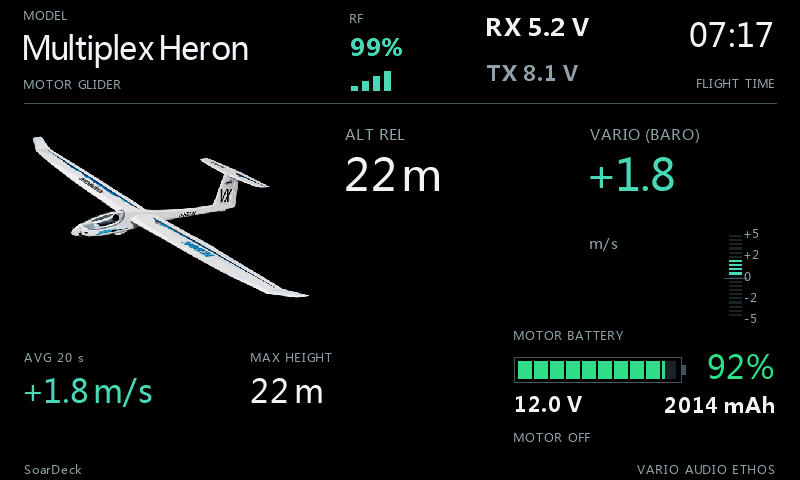
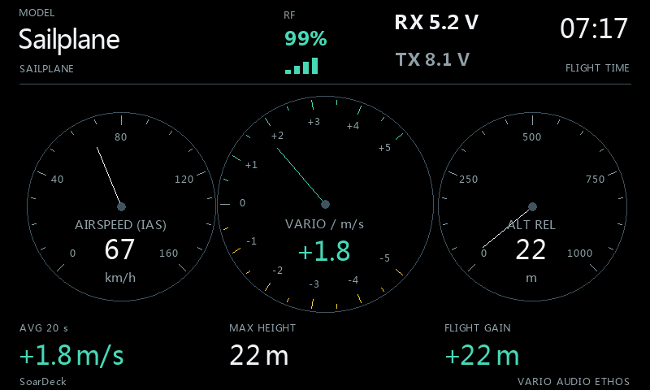

# SoarDeck

Sailplane and motor-glider instruments for FrSky ETHOS, in the VoltDeck and GasDeck family.

**Stable release: SoarDeck 2026.10-v1** · Suite version **26.10.1**

[Download the release ZIP](https://github.com/bliatun-code/SoarDeck/releases/latest) · [Illustrated walkthrough](docs/Walkthrough.md) · [Norsk bildeguide](docs/Bildeguide-norsk.md)

## Choose your instruments

- **Deck:** large digital altitude and climb readings.
- **Classic:** round instruments inspired by sailplane panels.
- **Thermal:** averaged climb and recent altitude/vario history.
- **Daylight:** a light background for a different viewing preference.
- Choose **Sailplane** or **Motor glider**, then show a model picture or give its area to instruments.
- Add actual pitot airspeed, GPS ground speed, RX/TX voltage and link readings when those sources exist.
- Motor energy supports guarded consumed mAh, a percent sensor or a labelled voltage estimate.

The [walkthrough](docs/Walkthrough.md) shows all **16 combinations** with a source table for each example profile.
Screenshots show the actual app in the ETHOS simulator with illustrative telemetry.

## Install

1. Download **SoarDeck-2026.10-v1.zip** from [Releases](https://github.com/bliatun-code/SoarDeck/releases/latest).
2. Back up the model and settings. Connect the radio's script storage in FrSky Suite.
3. Open **Lua library → Install Lua scripts**, select the ZIP and click **Install scripts**.
4. Restart ETHOS. Add **SoarDeck** to a full-screen widget area and open **Configure widget**.
5. Choose model type and real telemetry sources. Zero relative altitude on the ground. Keep **Synthetic preview** off for live use.

For manual installation, copy all five extracted files into <code>/scripts/SoarDeck/</code>:

<code>main.lua</code>, <code>ethos_lua_manifest.json</code>, <code>INSTALL.txt</code>, <code>LICENSE</code>, <code>NOTICE.md</code>.

Keep an existing configured widget and its saved settings when updating. If an older version still appears after restarting,
remove only <code>/scripts/SoarDeck/main.luac</code> and restart again. Model images are separate files; none is bundled with the ZIP.

[English setup](docs/Configuration.md) · [Norsk oppsett](docs/Konfigurasjon-norsk.md)

## Vario audio and measurement

Configure native ETHOS **Play vario** separately with the same **VSpeed** source and a physical activation switch.
SoarDeck does not enable that function or measure whether it is sounding. The altitude-derived visual fallback does not create an audio source.

Relative altitude is height above the launch reference, not terrain-following AGL. Ordinary barometric vario is not TE/netto.
GPS ground speed is separate from measured pitot airspeed. Missing or stale readings remain unavailable.

## Compatibility

Simulator coverage includes X20RS on ETHOS **1.6.6**, **26.1.2** and **26.2.0-RC2**; physical-radio feedback covers **26.1.2**.
RC coverage is exploratory. Check the actual sources, units and behaviour on your radio/model combination.

## Deck family

| App | Best suited to | Main instruments |
| --- | --- | --- |
| [VoltDeck](https://github.com/bliatun-code/VoltDeck) | Electric powered models | Flight-pack capacity, current, electrical power and motor telemetry. |
| [GasDeck](https://github.com/bliatun-code/GasDeck) | Gasoline powered models | Receiver batteries, engine RPM, temperatures and fuel. |
| [SoarDeck](https://github.com/bliatun-code/SoarDeck) | Sailplanes and motor gliders | Altitude, vario, history and motor-battery capacity when applicable. |

Each project has its own repository, illustrated guides and releases.

## License

[MIT license](LICENSE) · [Artwork and trademark notices](NOTICE.md)
