# SoarDeck – bildeguide

[Hjem](../README.md) · [Full oppsettsveiledning](Konfigurasjon-norsk.md) · [English](Walkthrough.md)

Bildene viser den faktiske SoarDeck 2026.10-v1 i **ETHOS 26.1.2 / X20RS, 800 × 480**.
Telemetrien er eksempeldata. Sensorene under beskriver hvordan du kan bygge tilsvarende oppsett; det er ikke målinger fra tilkoblet utstyr.
Kildenavn kan være endret i ETHOS. Velg riktig måling og enhet, også når flere sensorer tilbyr samme navn.

## 1. Rent seilfly med bilde

Velg **Model type = Sailplane**, **Model image = Selected model**, **Units = Metric**.
Bildet hentes fra valgt ETHOS-modell. Her brukes simulatorens seilflybilde.
Motorbatterifeltet fjernes, og seilflyinstrumentene bruker plassen.

| Felt | Eksempelkilde | Måling fra |
| --- | --- | --- |
| Altitude source | Altitude — m | Integrert barovario, for eksempel ARCHER Plus GR8 |
| VSpeed source | VSpeed — m/s | Samme barovario |
| RX voltage | RxBatt — V | Mottakerforsyning, 5,2 V i eksemplet |
| Link / Rx VFR | Rx VFR — % | Mottakerens linkmåling, 99 % |
| TX voltage | TX battery — V | Radioens batterikilde, 8,1 V |
| Flight timer from / ETHOS timer | ETHOS timer / Flight timer — s | Valgt radiotimer, 07:17 |
| Flight active switch | Flight | Bryter for appens flygestatus |

Du trenger verken motorbatterisensor, pitot eller GPS til dette oppsettet.
**Show pitot airspeed** og **Show GPS ground speed** er av i bildeeksemplene.
Med en mottaker uten barovario kan **VARI ADV** levere høyde og VSpeed. Velg det sammenhørende kildeparet.
Eldre **VARI-H** er et S.Port-alternativ. Sensor og mottakerport må bruke kompatibel protokoll.

## 2. Multiplex Heron med motorbatteri

Velg **Model type = Motor glider** og **Model image = Selected model**, og legg Heron-bildet på den aktuelle ETHOS-modellen.
Det kompakte batterifeltet gir plass til seilflyinstrumentene. Dette er et mulig eksempeloppsett, ikke en opplysning om hvilken mottaker eller ESC Heron-modellen faktisk har.
Behold baro-, RX-, link- og timerkildene over og legg til:

| Felt | Eksempelvalg | Forklaring |
| --- | --- | --- |
| Remaining from | Consumed mAh | Kapasitet minus godkjent forbruk |
| Chemistry / Cells / Capacity | LiPo / 3 / 2200 mAh | Må samsvare med det faktiske batteriet |
| Pack voltage | VFAS — V | Fremdriftsbatteriets spenning fra f.eks. FAS40 ADV |
| Current | Current — A | Samme sensor, mellom batteri og ESC |
| Consumed mAh | Consumption — mAh | ETHOS-beregnet Consumption-sensor med Current som kilde |
| Motor active switch | Motor | Motor-/armeringskommando; kontroller riktig AV/PÅ |

Bildene viser **11,97 V**, **0,0 A**, **186 mAh brukt**, og dermed **2014 mAh / omtrent 92 %** etter godkjenning.
RX-spenningen er BEC-/mottakerforsyning og skal ikke brukes som motorbatterispenning.
Kontroller at strøm og spenning i motoroppsettet passer sensorens grenser; FAS40 ADV er bare et eksempel.
En telemetri-ESC som **Neuron II** kan i stedet levere batterispenning, strøm og **ESC Consumption** direkte.
En vanlig ESC uten slik telemetri gir ikke automatisk disse kildene.

For beregnet mAh: oppdag Current i **Model → Telemetry**, opprett **Consumption** med denne strømkilden og **mAh**, og velg den i SoarDeck.
Start-/nullstillingsregelen må samsvare med batteriet som faktisk er montert. En persistent teller kan ikke hente inn forbruk mens strømtelemetri manglet.
Et nytt batteri trenger først en stabil kontroll med lav strøm. Når appen ber om det, velg **Accept battery...**, kontroller batteri og teller, og trykk Confirm.
Dialogen gir inntil 60 sekunders lesetid og sjekker ferske data ved Confirm. Reelle endringer eller bortfall kan fortsatt kreve ny kontroll.

## 3. Bare instrumenter og valgfrie fartssensorer

Velg **Model image = Hidden**. Instrumentene overtar bildeområdet, uten et tomt felt.
Instrumenteksemplene beholder seilfly-/Heron-oppsettet over og har i tillegg disse fartskildene konfigurert:

| Felt | Eksempelkilde | Ekstra sensor |
| --- | --- | --- |
| Show pitot airspeed / Airspeed source | On / Air speed — m/s | Kompatibel pitotsensor, f.eks. ASS-70 på S.Port; 18,5 m/s = 66,6 km/h |
| Show GPS ground speed / Ground-speed source | On / GPS speed — m/s | GPS ADV på kompatibel S.Port-/FBUS-port; 17,2 m/s = 61,9 km/h |

Stilen bestemmer hvilke ekstra målinger som får plass. Her viser Classic uten modellbilde og Daylight-Heron uten modellbilde pitotfart; ingen av disse 16 bildene viser et GPS-fartsfelt. Deck og Thermal prioriterer seilflymålinger og historikk i disse oppsettene.
Fartssensorene er valgfrie også med modellbilde. Du kan like gjerne velge Hidden og bare bruke barovario.
GPS måler bakkefart, ikke luftfart. Appen beregner ikke stallvarsel, TE- eller netto-kompensering.
Velg **Lowest cell voltage** bare med en ekte cellemåling, for eksempel en egnet minste-celle-kilde fra **FLVS ADV**.
Totalspenning delt på antall celler forteller ikke hvilken celle som er svakest.

## 4. Referanse, respons og variolyd

Eksemplene bruker **Relative to zero**, **Vario scale ±5 m/s**, **Average period 20 s** og **History window 60 s**.
Nullstill høyde på bakken før flyging. Eksempelsekvensen ender på +21,6 m og +1,8 m/s; appen bygger selv gjennomsnitt og historikk fra sekvensen.
Heron-historikken markerer en kort motorfase først; motoren er AV i sluttbildet.
Thermal-eksemplene har **History plot = Vario**; de øvrige bruker Altitude der stilen viser historikk.
Begynn gjerne med **Display damping = Normal (1.5 s)**. Dette endrer visningen, ikke ETHOS-lyden.

Opprett **Model → Special functions → Play vario**, velg samme native **VSpeed** og en fysisk aktiveringsbryter.
Juster Range/Center og lyd under **System → General → Vario**. ETHOS-teksten i SoarDeck bekrefter ikke at lyden er aktivert.

## 5. Alle 16 oppsett

### Deck

| Seilfly med bilde | Heron med bilde |
| --- | --- |
| 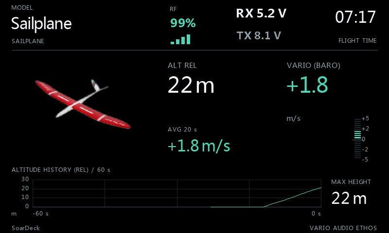 |  |

| Seilfly, instrumenter | Heron, instrumenter |
| --- | --- |
| 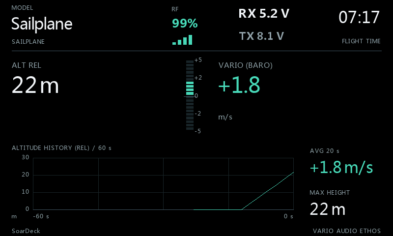 | 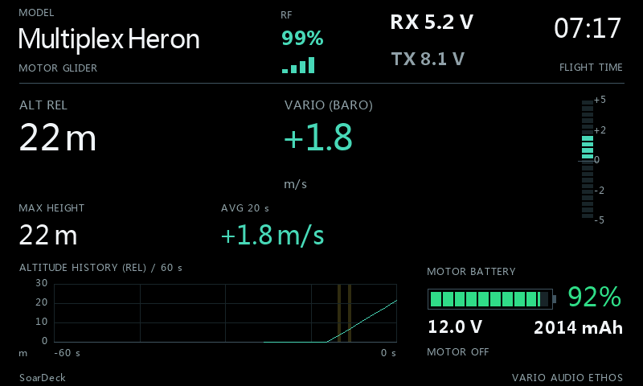 |

### Classic

| Seilfly med bilde | Heron med bilde |
| --- | --- |
| 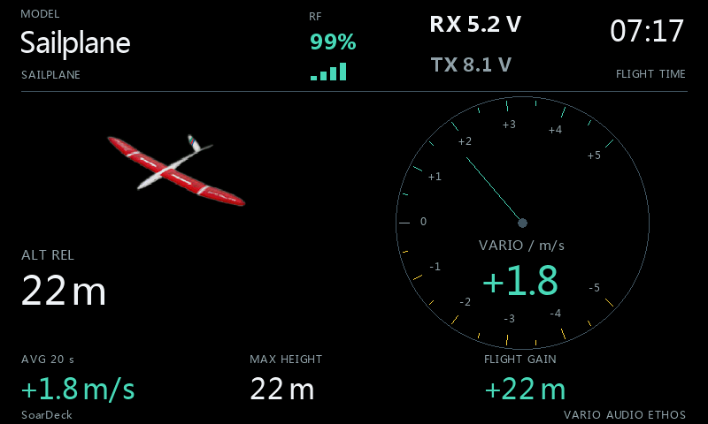 | 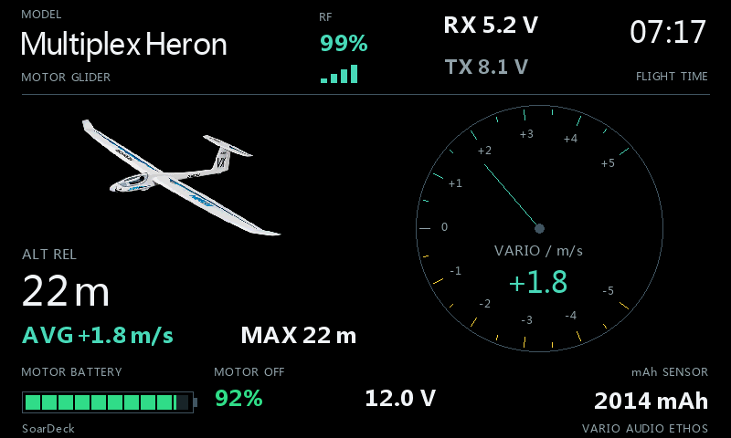 |

| Seilfly, instrumenter | Heron, instrumenter |
| --- | --- |
|  | 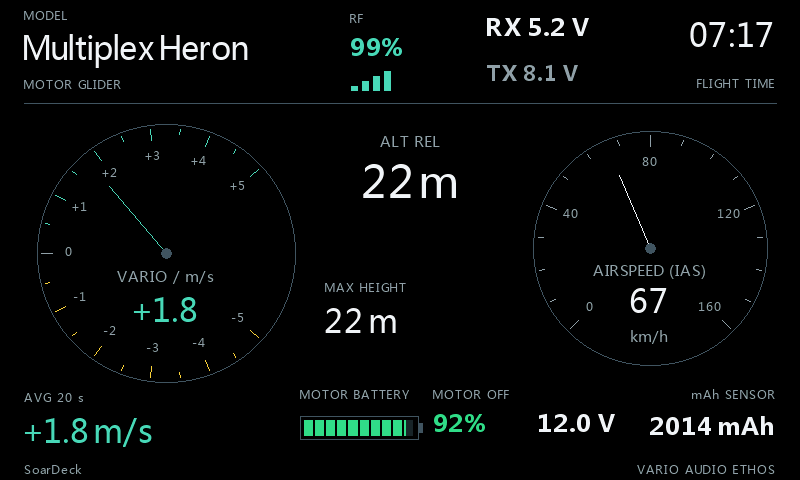 |

### Thermal

| Seilfly med bilde | Heron med bilde |
| --- | --- |
| 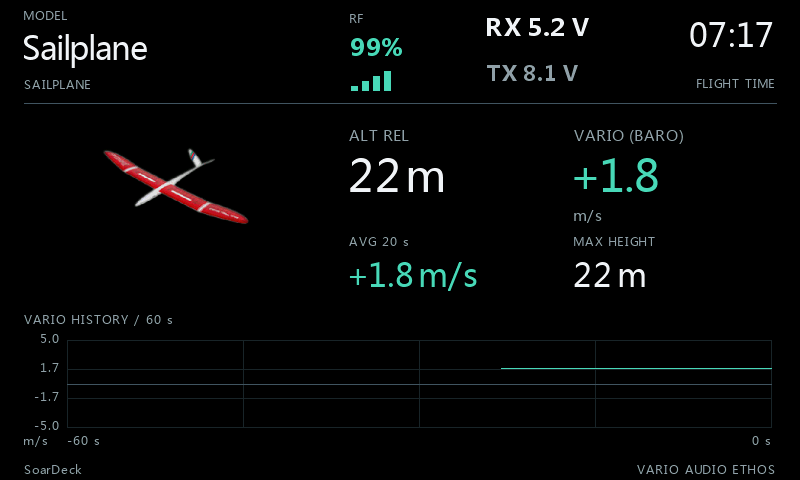 | 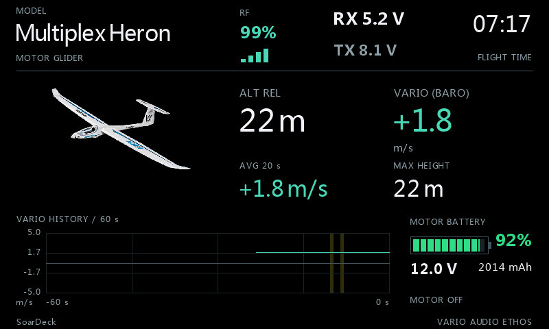 |

| Seilfly, instrumenter | Heron, instrumenter |
| --- | --- |
| 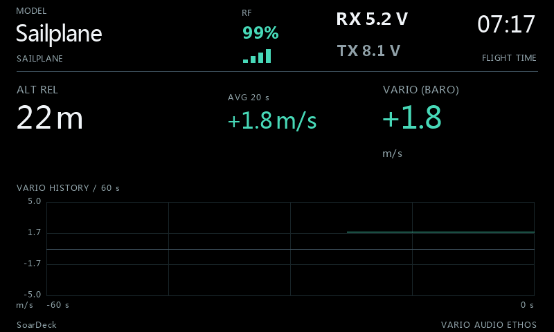 | 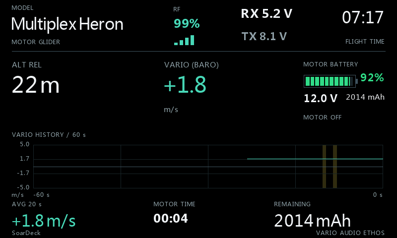 |

### Daylight

| Seilfly med bilde | Heron med bilde |
| --- | --- |
| 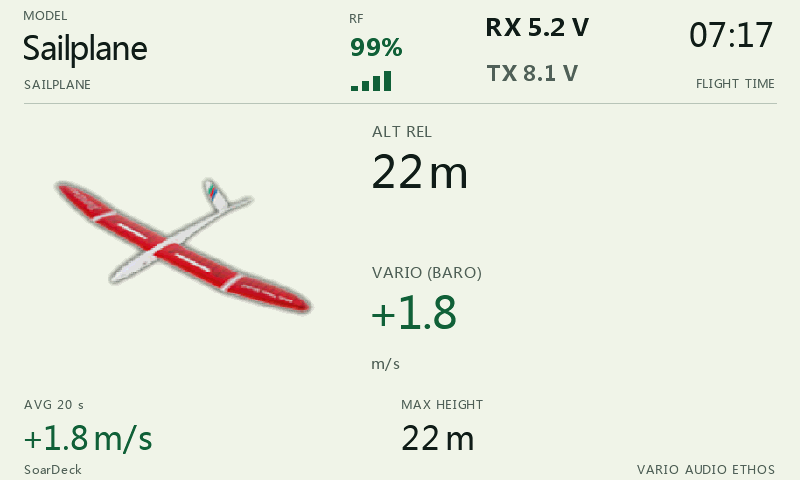 | 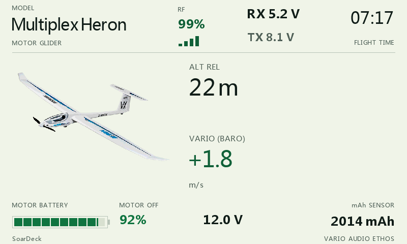 |

| Seilfly, instrumenter | Heron, instrumenter |
| --- | --- |
| 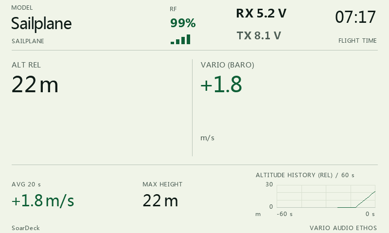 | 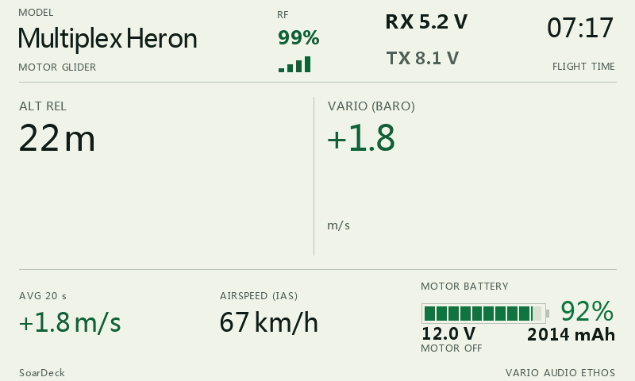 |

## Sensorreferanser

Se [sensorlenker og alternativer i den engelske guiden](Walkthrough.md#sensor-references) og produktmanualen for kobling, protokoll og elektriske grenser.
