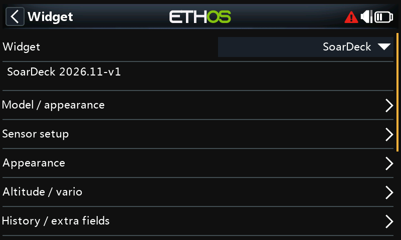
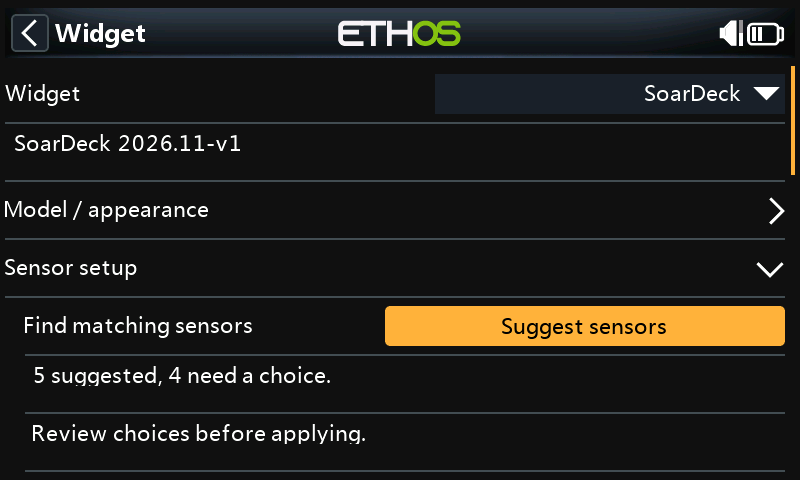
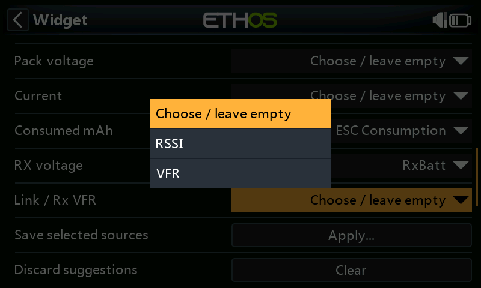
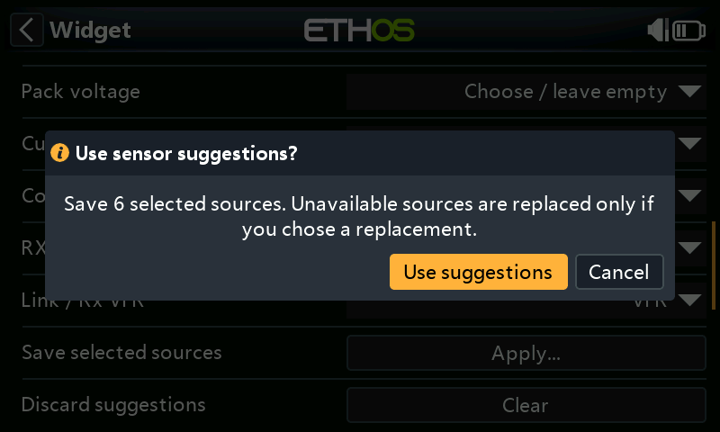

# Configure SoarDeck

**SoarDeck 2026.11-v4** · [Illustrated walkthrough](Walkthrough.md)

[Norsk](Konfigurasjon-norsk.md) · [Overview and installation](../README.md)

## After updating

SoarDeck 2026.11-v4 reads settings saved by earlier versions and saves them in a new format, so every source fits, including **Throttle source**. Check the sources in Configure after updating; select any that are missing again. Back up the model before returning to 2026.11-v3, which cannot read the new format and clears the SoarDeck setup when the model is saved.

## Choose the model and view

Open the widget menu and choose **Configure widget**. Under **Model / appearance**:

- **Model type:** Sailplane removes the motor-energy area. Motor glider adds a compact motor-battery display.
- **Display style:** Deck uses large digital readings; Classic emphasizes round instruments;
  Thermal emphasizes history; Daylight uses a light background.
- **Model image:** Selected model uses the ETHOS model image; Image file selects your own file;
  Hidden gives the entire image area to instruments.
- **Units:** Metric displays metres, m/s and km/h; Imperial displays feet, ft/min and mph.

Use an ordinary **8-bit RGB/RGBA PNG**, preferably with a transparent background.
The image must have at most **160,000 pixels**, width at most 800 and height at most 480.
A 320 × 180 picture fits comfortably. An 800 × 480 picture exceeds the pixel limit.
The aspect ratio is retained. Hidden is the correct choice for an instrument-only display.
For **Image file**, copy the picture to `/bitmaps/models/` on the radio, then select it in the
**Image file** field. Model pictures are separate from the widget ZIP.

## Use a full-screen widget area

The widget area must match the radio's actual LCD width and height. This is not an 800 × 480 product
limit; a smaller matching LCD/window pair is also full screen. A split area shows **Full screen required**
and clears the old instrument view. Restore a full-screen area to resume the instruments automatically.
If the LCD dimensions are unavailable or invalid, **Screen size unavailable** is shown and the app retries
at a bounded rate. Telemetry processing, battery qualification, timers, history and alerts continue.

## Advanced settings

**Configure widget** opens with the everyday settings. Turn on **Advanced settings** at the top and reopen Configure to show tuning fields such as damping, timeouts and motor and log thresholds. Hidden fields keep their values and continue to work. The switch returns to OFF after a restart. Fields marked **(Advanced settings)** below appear only when it is on.

## Sensor setup

Discover the model's sensors in **ETHOS → Telemetry** first. Open **Configure widget → Sensor setup** after choosing **Model type**.

1. Press **Suggest sensors**. Matches use the measurement type, unit and sensor name.
2. Review the list. Choose a sensor where alternatives are offered; leave unused fields empty.
3. Press **Apply...**, check the confirmation and choose **Use suggestions**. **Cancel** saves nothing.

Available selections are kept, including sensors that are temporarily offline. A missing source is replaced only when you choose a replacement. **Clear** discards the suggestions. You can still use the ordinary source fields.

**Sailplane** offers flight and receiver sensors; **Motor glider** also offers motor-battery sensors. Choose a matching altitude/VSpeed pair if several barometers are fitted.

Sensor setup does not create calculated sensors. If consumed mAh is missing, create a consumption sensor from current in ETHOS, then run **Suggest sensors** again. Confirm the battery settings and telemetry before flying.

<table>
<tr><td> <b>Open Sensor setup</b></td><td> <b>Find suitable sensors</b></td></tr>
<tr><td> <b>Choose between alternatives</b></td><td> <b>Confirm before saving</b></td></tr>
</table>

These menu captures show SoarDeck 2026.11-v3 in the ETHOS 26.2.0 RC2 X20RS simulator with example sensors. Names and match counts depend on your model.

## Select altitude and VSpeed

Discover the receiver/sensors in ETHOS telemetry first. Select sources by their actual measurement,
not just by a familiar name. An integrated receiver barovario or a compatible external variometer
can provide altitude and VSpeed. Select a matching pair when more than one barometer is fitted.

1. Set **Altitude source** to a live altitude measurement in metres or feet.
2. Set **VSpeed source** to the live vertical-speed measurement, normally in m/s.
3. Choose **Altitude reference → Relative to zero**, then use **Zero altitude → Zero...**
   while on the ground. Repeat at the start of each flying session.
4. Leave **Derive vario from alt** off when a real VSpeed source exists.

Relative mode shows `ALT REL`, measured from that zero. It is not AGL above the terrain.
**Sensor altitude** shows the sensor's altitude unchanged; its reference depends on the sensor/ETHOS setup.
The app does not establish a QNH/MSL reference for it. Zeroing is blocked during an active flight,
with a running motor, or when a selected flight/motor switch has unknown state.

In **Relative to zero**, **Zero altitude** also restarts maximum height, height gain, averaging and
history from the new zero. Flight/motor times and battery consumption are kept. In **Sensor altitude**,
zeroing only stores a reference for later use in relative mode; the current altitude, statistics and
history are kept.

Changing **Altitude source** clears the stored relative zero and restarts altitude statistics,
averaging and history. Zero the new source on the ground before using relative altitude.
Changing **Altitude reference** also restarts those statistics, averaging and history, while keeping
the stored relative zero. Both changes keep flight/motor times and battery consumption.

**Derive vario from alt** is a visual fallback when only altitude exists. It differentiates successive
valid altitude readings and labels the result as derived. Sensor resolution and update rate affect it.
It does not export a calculated VSpeed source for native audio. Ordinary barometric VSpeed is not
total-energy-compensated or netto lift.

## Set response and history

Start with **Vario scale ±5 m/s**, **Display damping Normal (1.5 s)** and **Average period 20 seconds**.
Choose ±2.5 or ±10 m/s for a narrower/wider display. Damping affects the app's display, not the sensor
or native ETHOS audio. Average period can be 5, 10, 20 or 30 seconds. **Display damping**, **Average period** and **Data timeout** are under **Advanced settings**.

**History plot** selects altitude or vario; **History window** selects 30/60 seconds or 2/5 minutes.
Motor activity is marked separately. History does not locate a thermal. Missing data breaks the
history/average rather than joining readings across a telemetry gap.

**Data timeout** defaults to 3 seconds. Set it to suit the real sensor update rate. Invalid/stale sources
show dashes or unavailable status, without moving instruments. Display units may be Imperial, but
**Vario scale** choices remain in m/s and **Height limit** remains in metres as labelled in setup.

The timeout uses telemetry-sensor age. A Lua or calculated source must itself signal missing input;
SoarDeck cannot age a last numeric value that the source keeps holding.

## Configure native vario sound

SoarDeck uses ETHOS's native variometer audio. It does not generate continuous vario sound itself.

1. In ETHOS **Model → Special functions**, add **Play vario**.
2. Select the **same native VSpeed source** selected in SoarDeck.
3. Set **State → Enable** and choose a **physical activation switch** under **Active condition**
   so you can enable or silence it deliberately.
4. Set **Range** and **Center** in that function; choose a silent center if wanted.
5. Under **System → General → Vario**, adjust volume, zero/max pitch and repeat to preference.

Climb uses rising-pitch beeps; sink uses a continuous falling-pitch tone. Native audio runs independently
of which widget is visible. An `ETHOS` indication in SoarDeck identifies the audio arrangement, not an
audible/on-state measurement. Synthetic preview does not switch off a separately enabled native vario.
See [ETHOS Play vario](https://ethos-doc.frsky-rc.com/model-setup/special-functions/) and
[Vario audio settings](https://ethos-doc.frsky-rc.com/system-setup/general/).

## Add relevant extra readings

Select **RX voltage**, **TX voltage** and **Link / Rx VFR** under RX / link. Use the receiver's appropriate
link measurement; the displayed unit distinguishes percent from dB. RX voltage is the receiver/BEC
feed and is not the motor battery's charge measurement.

Enable **Show pitot airspeed** only with a real pitot airspeed source. **Show GPS ground speed** uses
a separate GPS speed source. GPS ground speed is not IAS and cannot supply a stall indication.
No pitot/GPS sensor is needed for basic altitude/vario operation.

## Set the motor battery

These controls apply to **Motor glider**. Set **Chemistry**, **Capacity** and **Cells** to the actual pack,
then select the motor pack's sources; do not substitute BEC output or receiver voltage.

| Remaining from | Required setup | Meaning |
| --- | --- | --- |
| Consumed mAh | Pack voltage, current, consumed-mAh source and correct capacity | Capacity minus the accepted consumed counter |
| Percent sensor | A valid 0–100% source | The sensor's percentage, with no voltage fallback |
| Voltage estimate | Pack voltage, chemistry and cells | Approximate percentage from voltage; labelled as an estimate |

Select **Lowest cell voltage** only from a real cell measurement. Dividing pack voltage by cell count
does not identify the weakest cell. A current sensor needs an appropriate consumed-mAh source in
ETHOS; the app does not invent consumption from motor time or integrate a missing counter.

For Consumed mAh, each new battery needs **10 continuous seconds** with pack voltage spanning at
most **0.20 V for the whole pack**, at current no higher than
`min(1.5 A, max(Idle current floor, 3 × capacity_mAh / 20000))`.
**Idle current floor** (Advanced settings) defaults to **0.3 A** and can be increased to **1.5 A** in **0.1 A** steps.
The field is available for Motor glider with Consumed mAh; other measurement methods keep their own behaviour.
At the default setting, a 450–1500 mAh pack permits up to 0.3 A, while a 3300 mAh pack permits 0.495 A.
Servo load above the effective limit can still interrupt the check with the motor stopped.
Changing the floor starts a new battery check. Existing widgets receive the 0.3 A default and retain
all other settings; the value is saved with the widget.

Until accepted, percentage and remaining mAh stay unknown. A worst-case voltage/counter disagreement
of at most 10 percentage points can be accepted automatically; more than 10 through 20 requires
**Battery counter → Accept...** after checking actual charge, cells, chemistry, capacity and counter.
More than 20 cannot be accepted. Open **Accept battery...** from the widget menu to see why a check
is blocked. For a voltage mismatch, compare the configured pack with the measured voltage and the
voltage per configured cell. Where available, the dialog compares the counter's remaining charge
with the voltage estimate. Check the cell count, chemistry, pack-voltage source and counter as
indicated by the message. LiFe needs manual confirmation because its flat voltage curve cannot
reliably verify charge.

Manual acceptance requires a known motor OFF state. With **Switch + throttle**, turn the motor switch
off. In **Switch or current**, a selected switch must read at or below **Motor ON above** (Advanced settings). With no
selected switch in that mode, current must be below **Motor current gate** (Advanced settings). The app checks this
again when **Confirm** is pressed, so an open dialog cannot approve the counter after the motor is
armed. Manual acceptance also checks the same effective
idle-current limit. **Motor current gate** is a separate motor-status setting and does not replace the
battery-check limit.

Once accepted, normal voltage sag or motor load does not restart the comparison. An unexpected
consumption-counter decrease makes remaining capacity unknown and needs a fresh check and explicit
acceptance. **Pack loss delay** (Advanced settings) defaults to 10 seconds; sustained loss starts a new battery episode.
Brief loss gives missing values and does not silently approve a reset. Radio restart requires a new check.
Stopping the motor and starting a new flight keep battery consumption.

Battery colours use green above 40%, yellow at 40%, orange at 35% and red at 30% or below.
**Low motor battery** enables the separate sound alert at **Battery reserve**, default 30%.
An unknown value does not trigger a false zero-charge alert.

## Flight and motor time

With **Flight timer from → Flight switch / manual**, select **Flight active switch** or use
**Start flight / End flight** in the widget menu. A selected switch takes precedence over manual control.
Motor OFF does not end a sailplane flight.

**ETHOS timer** displays the selected radio timer. The flight switch or manual state still tells
SoarDeck when the model is flying, including for flight logging and motor-time tracking.

**New flight → Reset...** clears app flight/motor times, maximum height, height gain, average and history
while on the ground.
It keeps battery consumption and the selected altitude reference. Zero altitude separately.

### Motor detection with a switch and throttle

Under **Configure widget → Flight / motor**, set **Motor detection → Switch + throttle**.
Select **Motor active switch** and **Throttle source**. Use **Motor ON above** to define when
the switch is on. Set **Throttle low (raw)** and **Throttle high (raw)** to the source readings
at idle and full throttle, then choose the percentage under **Motor throttle above**.
These threshold fields are under **Advanced settings**.

**Motor ready** means the switch is on and the throttle is at or below the chosen threshold.
Above it, SoarDeck shows **Motor on**, adds motor time during the flight and marks the motor run
in **Altitude history**. Select **History plot → Altitude** under **History / extra fields** to see the
marking. Motor status describes the selected controls. [Illustrated example](Walkthrough.md#motor-ready-and-motor-on).

## Flight log

1. Open **Configure widget → Flight log** and turn on **Enable log**. Set **Flight minimum**
   (Advanced settings) to the flight time required to count a flight.
2. Use **Flight active switch**, or use **Start flight / End flight** from the widget menu if no
   flight switch is selected. Logging needs a live altitude or VSpeed reading. A telemetry gap
   pauses counted flight time. Motor OFF leaves the flight running so the glide is included.
3. Open **Flight log** from the widget menu to see the current or last counted flight. Choose
   **Dashboard** from the same menu to return to the instruments.

The log shows flight time, altitude and vario graphs, climb and sink, and available speed and link
readings. Motor gliders also show motor time and available battery readings. **Auto-open log** and
**Extra log delay** (Advanced settings) let the log open after a counted flight when the widget has focus. The flight
count is saved per model. Flight details are available until a restart or model change. SoarDeck
loads only for models that use it and is released again when you switch to a model without it.
[Illustrated example](Walkthrough.md#review-a-flight).

## Alerts and preview

Enable **Height alert** and set **Height limit** in metres for the selected altitude reference.
**Alert repeat** (Advanced settings) controls repeats for app height/battery warnings; it does not configure native vario beeps.

**Synthetic preview** shows illustrative readings with app alerts, real flight counting and battery
acceptance disabled. Turn it off for live telemetry, and use the native vario switch separately.
