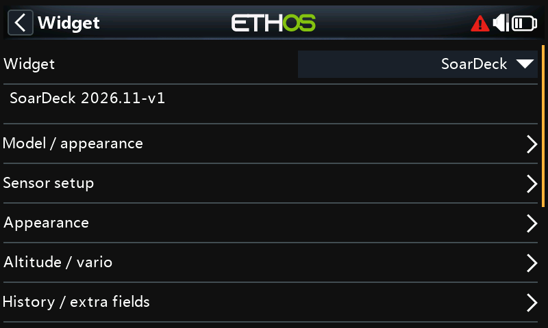
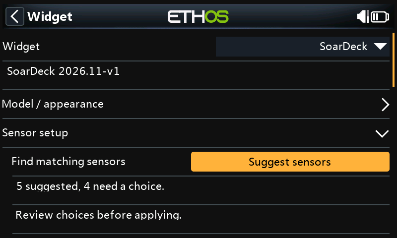
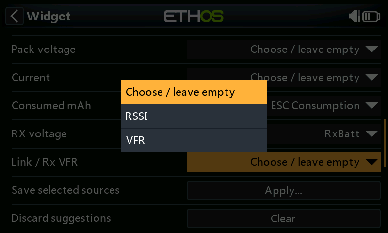
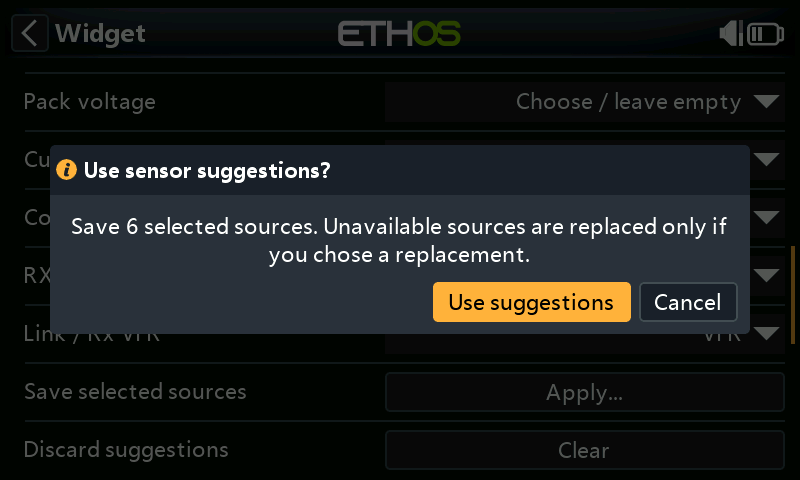

# Konfigurere SoarDeck

**SoarDeck 2026.11-v4** · [Bildeguide](Bildeguide-norsk.md)

[English](Configuration.md) · [Oversikt og installasjon](../README.md)

## Etter oppdatering

SoarDeck 2026.11-v4 leser innstillinger fra tidligere versjoner og lagrer dem i et nytt format, slik at alle kilder får plass, også **Throttle source**. Kontroller kildene i Configure etter oppdateringen, og velg på nytt de som mangler. Ta backup av modellen før du går tilbake til 2026.11-v3. Den versjonen kan ikke lese det nye formatet og tømmer SoarDeck-oppsettet når modellen lagres.

## Velg modell og visning

Åpne widgetmenyen og **Configure widget**. Under **Model / appearance** velger du:

- **Model type:** Sailplane fjerner motorbatterifeltet. Motor glider legger til en kompakt motorreserve.
- **Display style:** Deck har store digitale tall, Classic fremhever runde instrumenter,
  Thermal fremhever historikk, og Daylight har lys bakgrunn.
- **Model image:** Selected model bruker ETHOS-modellens bilde; Image file velger en egen fil;
  Hidden fordeler hele bildefeltet til instrumentene.
- **Units:** Metric viser meter, m/s og km/t; Imperial viser fot, ft/min og mph.

Bruk vanlig **8-bit RGB/RGBA PNG**, gjerne med gjennomsiktig bakgrunn. Bildet kan ha høyst
**160 000 piksler**, bredde 800 og høyde 480. Et bilde på 320 × 180 passer godt. 800 × 480
overskrider pikselgrensen. Sideforholdet beholdes. Velg Hidden for ren instrumentering.
For **Image file** kopierer du bildet til `/bitmaps/models/` på radioen og velger det i feltet
**Image file**. Modellbilder følger ikke med i widgetens ZIP-fil.

## Bruk et fullskjermsfelt

Widgetfeltet må ha samme bredde og høyde som radioens faktiske LCD. Dette er ikke en fast grense på
800 × 480; også en mindre LCD med et like stort widgetfelt er fullskjerm. Et delt felt viser
**Full screen required** og fjerner det gamle instrumentbildet. Velg fullskjerm igjen for å få
instrumentene automatisk tilbake. Hvis LCD-målene mangler eller er ugyldige, vises
**Screen size unavailable** mens appen prøver på nytt med avgrenset hyppighet. Telemetriberegning,
batterigodkjenning, tidtakere, historikk og varsler fortsetter i disse informasjonstilstandene.

## Advanced settings

**Configure widget** åpner med de vanlige innstillingene. Slå på **Advanced settings** øverst og åpne Configure på nytt for å se finjusteringer som demping, tidsavbrudd og grenser for motor og logg. Skjulte felt beholder verdien og virker som før. Bryteren går tilbake til OFF etter omstart. Felt merket **(Advanced settings)** nedenfor vises bare når den er på.

## Sensor setup

Oppdag modellens sensorer i **ETHOS → Telemetry** først. Åpne **Configure widget → Sensor setup** etter å ha valgt **Model type**.

1. Trykk **Suggest sensors**. Forslagene bruker målingstype, enhet og sensornavn.
2. Se gjennom listen. Velg sensor der flere passer; la ubrukte felt stå tomme.
3. Trykk **Apply...**, kontroller bekreftelsen og velg **Use suggestions**. **Cancel** lagrer ingenting.

Tilgjengelige kildevalg beholdes, også når sensoren midlertidig er frakoblet. En manglende kilde erstattes bare når du selv velger en erstatning. **Clear** forkaster forslagene. De vanlige kildefeltene kan fortsatt brukes.

**Sailplane** tilbyr fly- og mottakersensorer; **Motor glider** tilbyr også motorbatteriets sensorer. Velg et sammenhørende høyde-/VSpeed-par hvis flere barometre er montert.

Sensor setup oppretter ikke beregnede sensorer. Mangler consumed mAh, opprett en forbrukssensor fra strøm i ETHOS og kjør **Suggest sensors** på nytt. Kontroller batteriinnstillinger og telemetri før flyging.

<table>
<tr><td> <b>Åpne Sensor setup</b></td><td> <b>Finn passende sensorer</b></td></tr>
<tr><td> <b>Velg mellom flere treff</b></td><td> <b>Bekreft før lagring</b></td></tr>
</table>

Menybildene viser SoarDeck 2026.11-v3 i ETHOS 26.2.0 RC2-simulatoren for X20RS med eksempelsensorer. Navn og antall treff avhenger av modellen din.

## Velg høyde og VSpeed

Oppdag mottaker/sensorer i ETHOS-telemetri først. Velg etter faktisk måling, ikke bare et kjent navn.
En mottaker med integrert barovario eller et kompatibelt løst variometer kan gi høyde og vertikalfart.
Har du flere barometre, velg et sammenhørende høyde-/VSpeed-par.

1. Sett **Altitude source** til en levende høydemåling i meter eller fot.
2. Sett **VSpeed source** til målt vertikalfart, normalt i m/s.
3. Velg **Altitude reference → Relative to zero**, og bruk **Zero altitude → Zero...** på bakken.
   Gjenta ved starten av hver flyøkt.
4. La **Derive vario from alt** være av når en ordentlig VSpeed-kilde finnes.

Relativ modus viser `ALT REL` fra nullpunktet. Dette er ikke terrengfølgende AGL.
**Sensor altitude** viser kildens høyde uendret; referansen avhenger av sensoren og ETHOS-oppsettet.
Appen etablerer ikke QNH eller høyde over havet. Nullstilling sperres under aktiv flyging, med motoren
i gang, eller når en valgt fly-/motorbryter har ukjent tilstand.

I **Relative to zero** starter **Zero altitude** også maksimal høyde, høydegevinst, snitt og historikk
på nytt fra nullpunktet. Fly-/motortid og batteriforbruk beholdes. I **Sensor altitude** lagres bare et
nullpunkt for senere relativ visning; høyden, statistikken og historikken i sensorvisningen beholdes.

Bytte av **Altitude source** sletter det lagrede relative nullpunktet og starter høydestatistikk,
snitt og historikk på nytt. Nullstill den nye kilden på bakken før du bruker relativ høyde.
Bytte av **Altitude reference** starter også denne statistikken, snittet og historikken på nytt,
men beholder det relative nullpunktet. Begge endringer beholder fly-/motortid og batteriforbruk.

**Derive vario from alt** er en visuell reserve når bare høyde finnes. Den beregner endring mellom
gyldige høydemålinger og merker verdien som beregnet. Oppløsning og oppdateringstakt påvirker resultatet.
Den oppretter ingen beregnet VSpeed-kilde for native lyd. Vanlig barometrisk vertikalfart er verken
totalenergikompensert vario eller netto løft.

## Respons og historikk

Begynn med **Vario scale ±5 m/s**, **Display damping Normal (1.5 s)** og **Average period 20 seconds**.
Velg ±2,5 eller ±10 m/s for smalere/bredere skala. Dempingen gjelder appvisningen, ikke sensoren eller
ETHOS-lyden. Gjennomsnittet kan være 5, 10, 20 eller 30 sekunder. **Display damping**, **Average period** og **Data timeout** ligger under **Advanced settings**.

**History plot** velger høyde eller vario. **History window** velger 30/60 sekunder eller 2/5 minutter.
Motorkjøring markeres separat. Kurven viser utvikling, ikke termikkens posisjon. Manglende data bryter
historikk og snitt, slik at kurven ikke forbinder målinger over et telemetriavbrudd.

**Data timeout** er normalt 3 sekunder og tilpasses sensorens faktiske oppdateringstakt. Ugyldige/gamle
kilder gir streker eller utilgjengeligstatus; instrumentene flytter seg ikke. Selv med Imperial visning
angis **Vario scale** i m/s og **Height limit** i meter, slik feltene er merket.

Tidsgrensen bruker telemetrisensorens alder. En Lua-kilde eller beregnet kilde må selv melde manglende
måledata; SoarDeck kan ikke alderskontrollere et siste tall som kilden bare holder uendret.

## Sett opp variopip i ETHOS

SoarDeck bruker ETHOS sin innebygde variolyd. Appen lager ikke kontinuerlig variolyd selv.

1. Gå til **Model → Special functions** i ETHOS og legg til **Play vario**.
2. Velg **samme native VSpeed-kilde** som i SoarDeck.
3. Sett **State → Enable**, og velg en **fysisk aktiveringsbryter** under **Active condition**,
   slik at du kan slå lyden på og av.
4. Still **Range** og **Center** i funksjonen. Velg stille senterområde om ønskelig.
5. Under **System → General → Vario** stiller du volum, tonehøyde ved null/maks og repetisjon.

Stiging gir pip med stigende tonehøyde; synk gir sammenhengende tone med fallende tonehøyde.
Lyden er uavhengig av hvilken widget som vises. En `ETHOS`-indikasjon i SoarDeck beskriver lydopplegget;
den måler ikke om lyden faktisk er på. Synthetic preview slår ikke av en separat aktivert native vario.
Se [ETHOS Play vario](https://ethos-doc.frsky-rc.com/model-setup/special-functions/) og
[varioinnstillinger](https://ethos-doc.frsky-rc.com/system-setup/general/).

## Legg til relevante ekstrafelt

Velg **RX voltage**, **TX voltage** og **Link / Rx VFR** under RX / link. Bruk mottakerens aktuelle
linkmåling; enheten skiller prosent fra dB. RX-spenning er mottakerens/BEC-ens forsyning og er ikke
motorbatteriets ladetilstand.

Slå bare på **Show pitot airspeed** med en reell pitotkilde. **Show GPS ground speed** bruker en separat
GPS-fartskilde. GPS-bakkefart er ikke IAS og kan ikke gi stallindikasjon. Verken pitot eller GPS trengs
for grunnvisningen med høyde og vario.

## Konfigurer motorbatteriet

Disse feltene gjelder **Motor glider**. Sett **Chemistry**, **Capacity** og **Cells** etter den faktiske
pakken. Velg fremdriftsbatteriets kilder; ikke bruk BEC-utgang eller mottakerspenning som erstatning.

| Remaining from | Nødvendig oppsett | Betydning |
| --- | --- | --- |
| Consumed mAh | Pakkespenning, strøm, forbrukt-mAh-kilde og riktig kapasitet | Kapasitet minus godkjent forbruksteller |
| Percent sensor | Gyldig kilde på 0–100 % | Sensorens prosent, uten spenningsreserve |
| Voltage estimate | Pakkespenning, kjemi og celletall | Omtrentlig spenningsbasert prosent, merket som anslag |

Velg **Lowest cell voltage** bare fra en virkelig cellemåling. Pakkevolt delt på celletall avslører ikke
den svakeste cellen. En strømsensor trenger en egnet forbrukt-mAh-kilde i ETHOS. Appen finner ikke på
forbruk fra motortid og integrerer ikke strøm når en forbruksteller mangler.

For Consumed mAh trenger hvert nytt batteri **10 sammenhengende sekunder** med høyst **0,20 V variasjon
for hele pakken**, og strøm høyst
`min(1,5 A; max(Idle current floor; 3 × kapasitet_mAh / 20000))`.
**Idle current floor** (Advanced settings) er normalt **0,3 A** og kan økes til **1,5 A** i trinn på **0,1 A**.
Feltet er tilgjengelig for Motor glider med Consumed mAh; andre målemetoder beholder sin egen oppførsel.
Med standardverdien tillates opptil 0,3 A for pakker på 450–1500 mAh, mens 3300 mAh tillater 0,495 A.
Servolast over den effektive grensen kan fortsatt avbryte kontrollen selv om motoren er stoppet.
Endring av minstegrensen starter en ny batterikontroll. Eksisterende widgeter får standardverdien
0,3 A og beholder alle andre innstillinger. Verdien lagres med widgeten.

Inntil kontrollen er godkjent, er prosent og gjenværende mAh ukjent. Største avvik mellom teller og
spenningsreferanse på høyst 10 prosentpoeng kan godkjennes automatisk. Over 10 til og med 20 krever
**Battery counter → Accept...**, etter kontroll av faktisk lading, celler, kjemi, kapasitet og teller.
Over 20 kan ikke godkjennes. Åpne **Accept battery...** fra widgetmenyen for å se hva som stopper
godkjenningen. Ved spenningsavvik kan du sammenligne batterioppsettet med målt pakkespenning og
spenning per konfigurert celle. Når begge er tilgjengelige, viser dialogen gjenværende lading fra
forbrukstelleren og spenningsanslaget. Følg meldingen og sjekk celletall, kjemi, spenningskilde eller
forbruksteller. LiFe krever manuell bekreftelse fordi den flate spenningskurven gir et usikkert
anslag på lading.

Manuell godkjenning krever kjent motor OFF. Med **Switch + throttle** må motorbryteren være av.
I **Switch or current** må en valgt bryter stå på eller under **Motor ON above** (Advanced settings). Uten valgt bryter
i den modusen må strømmen være under **Motor current gate** (Advanced settings).
Appen kontrollerer dette på nytt når **Confirm** trykkes, slik at en åpen dialog ikke kan godkjenne
telleren etter at motoren er armert. Manuell godkjenning kontrollerer også den samme effektive
hvilestrømgrensen. **Motor current gate** er en separat innstilling for motorstatus og erstatter ikke
batterikontrollens strømgrense.

Etter godkjenning starter ikke normalt spenningsfall eller motorlast sammenligningen på nytt.
Uventet fall i forbrukstelleren gjør gjenværende kapasitet ukjent og krever ny kontroll og uttrykkelig
godkjenning. **Pack loss delay** (Advanced settings) er normalt 10 sekunder; langvarig bortfall starter en ny batteriøkt.
Kort bortfall gir manglende verdier og godkjenner ikke en tellernullstilling. Etter radioomstart må
batteriet kontrolleres igjen. Motorstopp og ny flyging beholder batteriforbruket.

Batteriet er grønt over 40 %, gult ved 40 %, oransje ved 35 % og rødt ved 30 % eller lavere.
**Low motor battery** slår på eget lydvarsel ved **Battery reserve**, normalt 30 %.
Ukjent verdi skal ikke gi et falskt nullkapasitetsvarsel.

## Flytid og motortid

Med **Flight timer from → Flight switch / manual** velger du **Flight active switch** eller bruker
**Start flight / End flight** i widgetmenyen. En valgt bryter overstyrer manuell start/stopp.
Motor OFF avslutter ikke en seilflyging.

**ETHOS timer** viser valgt radiotimer. Flybryteren eller manuell start/stopp forteller fortsatt
SoarDeck når modellen flyr, også for flylogg og motortid.

**New flight → Reset...** nullstiller appens fly-/motortid, maksimal høyde, høydegevinst, snitt og historikk
på bakken.
Batteriforbruk og valgt høydereferanse beholdes. Nullstill høyde separat.

### Motorregistrering med bryter og gass

Gå til **Configure widget → Flight / motor** og velg **Motor detection → Switch + throttle**.
Velg **Motor active switch** og **Throttle source**. Bruk **Motor ON above** til å angi når bryteren
er på. Sett **Throttle low (raw)** og **Throttle high (raw)** til kildeverdiene ved tomgang og full
gass. Velg deretter prosentgrensen i **Motor throttle above**.
Disse grensefeltene ligger under **Advanced settings**.

**Motor ready** vises når bryteren er på og gassen er på eller under grensen. Over grensen vises
**Motor on**, motortiden teller under flyging, og motorperioden markeres i høydehistorikken.
Velg **History plot → Altitude** under **History / extra fields** for å se markeringen. Statusen viser
hva bryteren og gasskilden melder. [Se bildeeksempel](Bildeguide-norsk.md#motor-ready-og-motor-on).

## Flylogg

1. Åpne **Configure widget → Flight log**, og slå på **Enable log**. Velg hvor mye flytid som
   kreves for at flygingen skal telle, i **Flight minimum** (Advanced settings).
2. Bruk **Flight active switch**. Hvis du lar bryterfeltet stå tomt, bruker du **Start flight / End
   flight** i widgetmenyen. Loggen trenger en aktiv høyde- eller VSpeed-kilde. Flytiden i loggen
   pauser ved bortfall av telemetri. Motorstopp avslutter ikke flygingen, så glidefasen blir med.
3. Åpne **Flight log** i widgetmenyen for å se pågående eller sist registrerte flyging.
   Velg **Dashboard** i samme meny for å gå tilbake til instrumentene.

Loggen viser flytid, høyde- og variografer, stig og synk, og tilgjengelige fart- og linkmålinger.
Motorglidere får også motortid og tilgjengelige batterimålinger. **Auto-open log** og
**Extra log delay** (Advanced settings) lar loggen åpnes etter en registrert flyging når widgeten har fokus. Flytelleren
lagres per modell. Detaljene fra flygingen er tilgjengelige fram til omstart eller modellbytte. SoarDeck
lastes bare for modeller som bruker appen, og slippes igjen når du bytter til en modell uten den.
[Se bildeeksempel](Bildeguide-norsk.md#se-gjennom-en-flyging).

## Varsler og forhåndsvisning

Slå på **Height alert**, og sett **Height limit** i meter for valgt høydereferanse.
**Alert repeat** (Advanced settings) gjelder appens høyde-/batterivarsler, ikke variopipene i ETHOS.

**Synthetic preview** viser illustrasjonsverdier med appvarsler, ekte flytelling og batterigodkjenning
deaktivert. Slå den av for levende telemetri, og bruk variobryteren separat.
